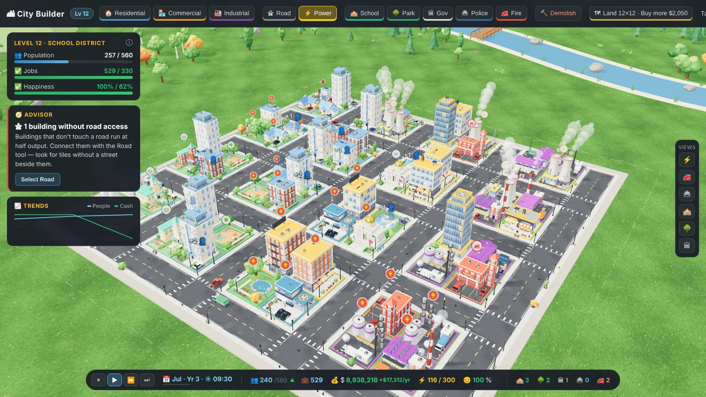
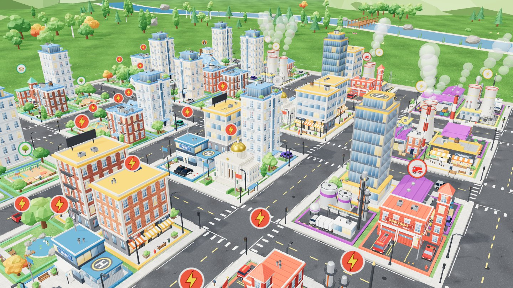
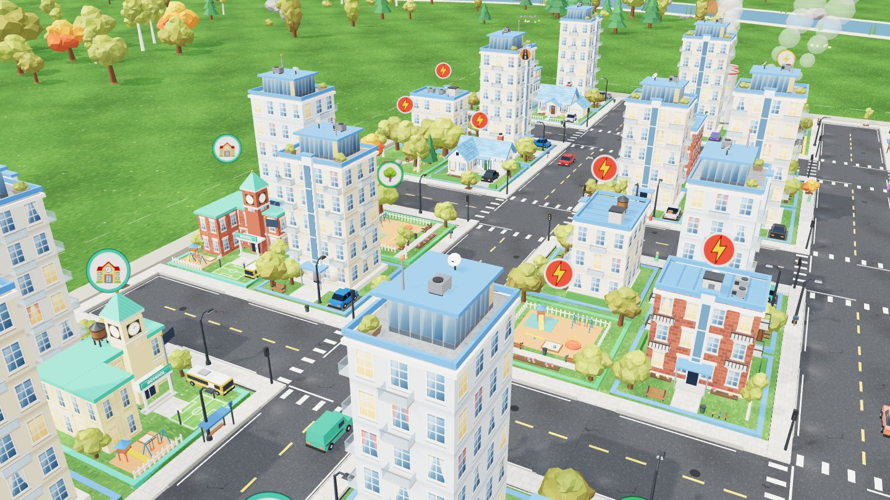
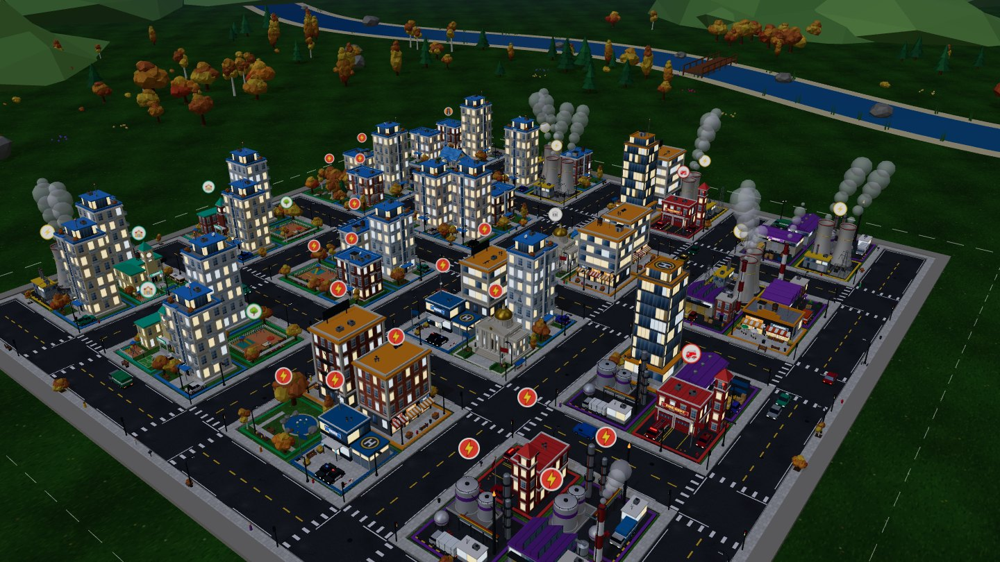
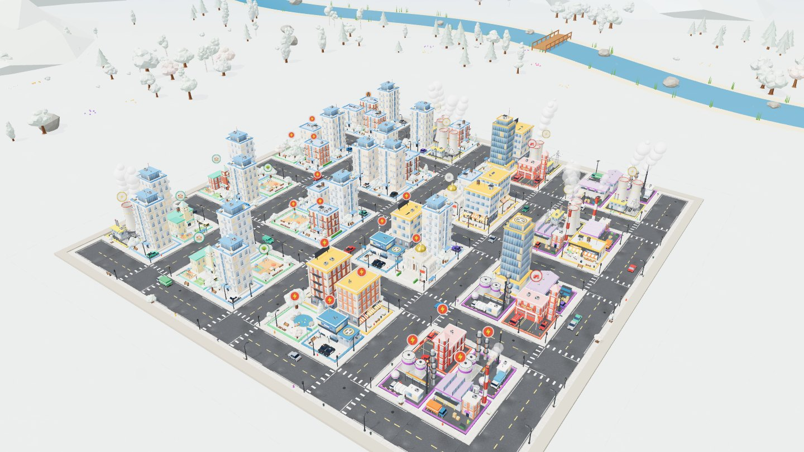

# City Builder

A 3D city-builder campaign that runs in the browser. Zone land, build roads, power the city, and grow the population across **50 levels in 5 eras**.

New players get a short step-by-step guide, a briefing before each level, an objectives panel with progress bars, and an advisor that always suggests the next step (with a guided walkthrough for the first build).

**▶ Play it live:** https://city-builder-omega.vercel.app/



| Downtown | Suburbs |
| --- | --- |
|  |  |
| **Night** | **Winter** |
|  |  |

---

## Features

- **Opening trailer:** on start-up the game builds a demo city in front of you, with camera shots from dawn to nightfall and a title card. Skip it with the button, Esc, Enter or Space; it is left out when your system asks for reduced motion.
- **50-level campaign** across five eras: Pioneer, Expansion, Industrial, Metropolis and Utopia. Later eras raise build costs, shrink power range, lower the tax cap and add yearly upkeep.
- **City simulation:** every in-game month residents move in, taxes come in and upkeep goes out (a year takes 48 seconds at normal speed). You also manage jobs vs. population, happiness, crime and random fires.
- **Power and roads:** buildings run at full output only when they're powered *and* touch a road (100% with both, 75% power only, 50% road only, 25% neither).
- **Zones and services:** Residential, Commercial, Industrial, Power Plant, School, Park, Government Office, Police Station and Fire Station. Each service covers a radius, which is highlighted while you place it.
- **Advisor and objectives:** a live panel shows goal progress and the single most useful next step.
- **Land that grows with you:** early levels start on a small 8×8 plot and later levels start bigger, up to the full 24×24 valley. Use the **🗺 Land** button to buy the next ring of land whenever you need more room.
- **Living world:** a five-minute day/night cycle with a clock in the HUD, seasons, rain and snow, cars and pedestrians, and placement and ambience sounds.
- **Detailed buildings:** cottages, townhouses, ranches and villas that grow into walk-ups and apartment blocks; shops, mid-rises and two kinds of office tower; factories, warehouses and refineries; five park layouts; and furnished streets with signals, lamps, trees and bus shelters.
- **Cosmetic building styles:** houses or apartments, shops, mid-rise or office towers, factories, warehouses or refineries.
- **Saved progress:** unlocked levels are stored in your browser's `localStorage`.

## How to play

1. **Power first.** Place a Power Plant. Its range shows in yellow before you place it.
2. **Draw roads.** Pick the Road tool and click-and-drag. Roads join up automatically.
3. **Zone.** Residential holds up to 15 residents, Commercial gives 20 jobs and Industrial gives 35. Keep jobs close to population.
4. **Add services.** Schools speed up growth, parks raise happiness and capacity, police cut crime, and fire stations prevent costly fires.
5. **Manage time and money.** Set the tax rate in the toolbar, and use ⏸ / ▶ / ⏩ (or **Space** to pause) to control speed.
6. **Buy land when you run out.** The dashed outline shows the next ring; the Land button shows its price.

Meet every goal in the Objectives panel at the same time to complete a level.

### Controls

| Action | Input |
| --- | --- |
| Build or demolish | Pick a tool, then click a tile on your land |
| Draw a road | Road tool, click and drag |
| Rotate the camera | Left-drag (any tool except Road) |
| Pan the camera | Right-drag |
| Zoom | Mouse wheel |
| Pause / resume | **Space** |
| Coverage views | The ⚡ 🚒 🚔 🏫 🌳 🏛 buttons on the right |

## Tech stack

- [Three.js](https://threejs.org/) r160, loaded from a CDN via an import map, with no build step
- Plain JavaScript ES modules, HTML and CSS
- Buildings, roads, trees, vehicles and scenery are modelled procedurally in code, with textures drawn on canvases at start-up.
- Deployed on [Vercel](https://vercel.com/) as a static site

## Run locally

The game uses ES modules and loads its sounds at start-up, so it has to be served over HTTP. Opening `index.html` straight from disk won't work.

```bash
git clone https://github.com/amananandrai/city-builder.git
cd city-builder
npm start          # runs `npx serve . --listen 3000`
```

Then open http://localhost:3000.

## Project structure

```
index.html          UI shell: guide, level select, briefing, HUD
style.css
js/
  main.js           scene setup, input, render loop
  simulation.js     economy, growth, happiness, crime and fire logic
  levels.js         the 50 levels, their goals, constraints and starting land
  constants.js      grid size, zone definitions, economy, day length, land price
  advisor.js        objectives and "next step" guidance
  intro.js          the opening trailer (demo city, camera shots, captions)
  buildings.js      every building model (homes, commerce, industry, services, parks)
  buildkit.js       shared parts: lots, roofs, balconies, smoke, flags
  props.js          trees, vehicles, street furniture, materials, mesh baking
  textures.js       procedural facade, ground and sign textures
  meshes.js         road auto-tiling, tile wrapper and badges, surrounding scenery
  assets.js         model and sound loading
  atmosphere.js, weather.js, effects.js         day/night, seasons, rain/snow, FX
  ui.js, state.js, events.js
assets/models, assets/sounds
docs/screenshots
tools/balance-bot.mjs   headless bot that plays every level to check difficulty
```

### Balance bot

`tools/balance-bot.mjs` plays each level with a simple build order and reports how long it takes to win, how many lots it used and how much land it had to buy. Re-run it after changing the economy, growth rates, land sizes or level table:

```bash
node tools/balance-bot.mjs          # all 50 levels
node tools/balance-bot.mjs 1,10,50  # specific levels
```

## License

[MIT](LICENSE) © 2026 Aman Anand Rai. The GLB models in `assets/models` are by [Kenney](https://kenney.nl/) (CC0); the game no longer draws them, since every model is now generated in code.
